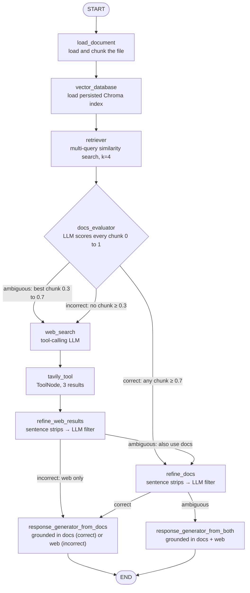

<div align="center">

# 🧪 CRAG: Corrective Retrieval-Augmented Generation

### A LangGraph implementation of the CRAG research paper. RAG that grades its own homework.

*Retrieval gets scored before the LLM is allowed to answer. Weak retrieval is corrected, not trusted.*

[](https://www.python.org/)
[](https://arxiv.org/abs/2401.15884)
[](https://www.langchain.com/langgraph)
[](https://www.langchain.com/)
[](https://groq.com/)
[](https://www.trychroma.com/)
[](https://tavily.com/)
[](https://huggingface.co/)
[](https://streamlit.io/)
[](LICENSE)

<br>


</div>

---

## Overview

Standard Retrieval-Augmented Generation has a quiet failure mode: it **trusts whatever the retriever returns**. If the retrieved chunks are irrelevant, the LLM still receives them as "context" and builds an answer on top of them.

**Corrective RAG (CRAG)**, proposed in [*Corrective Retrieval Augmented Generation* (Yan et al., 2024)](https://arxiv.org/abs/2401.15884), fixes this by adding a **retrieval evaluator** that judges the retrieved documents *before* generation and triggers a different corrective action depending on how confident it is.

This repository is a from-scratch implementation of that architecture as a **LangGraph state machine**, with a research-style Streamlit interface that exposes every decision the pipeline makes: the score of each chunk, the sentences kept or dropped, the web results, and the live path through the graph.

| Evaluator verdict | What the system does |
|---|---|
| 🟢 **Correct** (at least one chunk scores ≥ 0.7) | Keep the internal documents, refine them down to the relevant sentences, and generate from the documents |
| 🟡 **Ambiguous** (best chunk scores 0.3 to 0.7) | Refine the documents **and** run a Tavily web search, refine those results too, then generate from **both** |
| 🔴 **Incorrect** (no chunk reaches 0.3) | Discard the retrieved documents, search the web, refine, and generate from the **web only** |

At the end, the answer is either **grounded in the retained context** or an honest *"I don't have enough information in the provided context to answer this question."*

> **Scope note.** This is an architectural re-implementation of the paper's pipeline. It does not reproduce the paper's benchmark numbers. The [Fidelity to the Paper](#fidelity-to-the-paper) section lists exactly what is faithful, what is adapted, and what is out of scope.

---

## Table of Contents

- [Highlights](#highlights)
- [Architecture](#architecture)
- [Fidelity to the Paper](#fidelity-to-the-paper)
- [How I Studied the Paper](#how-i-studied-the-paper)
- [The Three Paths, Demonstrated](#the-three-paths-demonstrated)
- [Research UI](#research-ui)
- [LangGraph Concepts Demonstrated](#langgraph-concepts-demonstrated)
- [Design Decisions](#design-decisions)
- [Tech Stack](#tech-stack)
- [Project Structure](#project-structure)
- [Getting Started](#getting-started)
- [Configuration](#configuration)
- [Known Limitations](#known-limitations)
- [Roadmap](#roadmap)
- [Reference](#reference)
- [License](#license)

---

## Highlights

- **Faithful three-way correction logic.** Correct / Ambiguous / Incorrect routing with upper and lower confidence thresholds, as the paper describes.
- **Decompose, filter, recompose.** Retrieved text is split into sentence-level "knowledge strips", each strip is judged for relevance, and only the useful ones are recomposed into the context the generator sees.
- **Web correction through a real tool-calling loop.** A tool-bound LLM issues the Tavily call, and LangGraph's `ToolNode` executes it. The same refinement pass then cleans the web results.
- **Multi-query retrieval.** The LLM rewrites the user's question into several variants to widen recall before any scoring happens.
- **Strictly grounded generation.** Generator prompts allow only the retained context as a source of truth, require an exact refusal string when the context is insufficient, and tell the model to treat retrieved text as data and ignore instructions inside it (a prompt-level mitigation against injection).
- **Transparent by design.** The UI streams the graph's execution live, highlights the active node, and shows chunk scores, kept strips, raw Tavily output, and the full state trace.
- **Multi-format ingestion.** PDF, TXT, CSV and PowerPoint, each with its own chunking profile.
- **Persistent vector store.** Indexing is a separate step. Chroma persists to disk, so queries don't re-embed the document.

---

## Architecture



**Reading the graph.**

1. `retriever` pulls candidate chunks using multi-query retrieval.
2. `docs_evaluator` scores **each chunk** from 0.0 to 1.0 with an LLM judge. Chunks under the lower threshold are dropped, and the survivors decide the verdict.
3. A router sends the run down one of three paths. The Ambiguous path **reconverges** on `refine_docs` after the web branch, so one node serves two routes.
4. One generator node serves two statuses. On **Correct** it reads `refined_docs_context`, and on **Incorrect** it reads `refined_web_context`. A second generator merges both contexts for the Ambiguous case.

### The evaluator and its router

```python
# nodes.py: score every retrieved chunk, keep the useful ones
upper_threshold = 0.7
lower_threshold = 0.3

for doc in context:
    score = float(chain.invoke({"document": doc.page_content, "query": query}).content.strip())
    if score >= lower_threshold:          # chunks below 0.3 are discarded
        good_docs.append(doc); scores.append(score)

# any chunk ≥ 0.7 → "correct"; survivors but none ≥ 0.7 → "ambiguous"; none survive → "incorrect"
```

```python
# edges.py: three-way conditional routing
graph.add_conditional_edges("docs_evaluator", quality_check_router, {
    "correct":   "refine_docs",
    "ambigious": "web_search",     # spelling matches the state literal used throughout the code
    "incorrect": "web_search",
})
```

### Shared state

A single typed state flows through the graph, grouped by the stage that owns each field:

```python
class state(TypedDict):
    # traditional RAG
    doc_path: str;  query: str;  chunks: List[Document]
    database: Chroma;  retrieved_docs: List[Document];  response: str
    # evaluation
    good_docs: List[Document];  scores: List[float]
    status: Literal["correct", "incorrect", "ambigious"]
    # knowledge refinement
    kept_strips: List[str];  refined_docs_context: str
    # web correction (tool calling)
    messages: Annotated[list, add_messages];  refined_web_context: str
```

---

## Fidelity to the Paper

An honest mapping from the paper to this code. Where the implementation differs, it is stated plainly.

| Paper component | In the paper | In this repo | Status |
|---|---|---|---|
| **Retrieval evaluator** | A lightweight fine-tuned T5-large scores query-document relevance | Zero-shot **LLM-as-judge** (`gpt-oss-120b` on Groq) returns a 0.0 to 1.0 score per chunk | 🔶 Adapted |
| **Confidence thresholds** | Upper and lower thresholds produce Correct / Ambiguous / Incorrect | Upper **0.7**, lower **0.3**. *Correct* if any chunk ≥ 0.7, *Incorrect* if none reaches 0.3, *Ambiguous* otherwise | ✅ Faithful logic |
| **Knowledge refinement** | Decompose documents into strips, filter irrelevant ones, recompose | Regex sentence split → per-sentence LLM relevance check → concatenate the kept strips | 🔶 Adapted |
| **Correct action** | Use refined internal knowledge | Refine retrieved docs → generate from docs | ✅ Faithful |
| **Incorrect action** | Discard retrieval and fall back to web search | Discard docs → Tavily search → refine → generate from web | ✅ Faithful |
| **Ambiguous action** | Combine internal and external knowledge | Refine docs **and** web results → generate from both | ✅ Faithful |
| **Web search** | Rewrite the query into keywords, search, then refine the results | Tool-calling LLM issues the Tavily search (3 results), then refines them with the same strip filter. There is no dedicated keyword-rewrite stage | 🔶 Adapted |
| **Generator** | Plug-and-play, any LLM | `gpt-oss-120b` with strict context-only prompts | ✅ Faithful |
| **Benchmark evaluation** | PopQA, Biography, PubHealth, ARC-Challenge | Not reproduced | ⏳ Out of scope |

**Beyond the paper:** multi-query retrieval, multi-format ingestion, an exact refusal contract, a prompt-injection-aware generator prompt, and the interactive inspection UI.

---

## How I Studied the Paper

Before writing code I annotated the paper's architecture figure by hand, working out the threshold logic, what "ambiguous" means in practice, and how each verdict changes what the generator receives. The implementation follows these notes closely.


---

## The Three Paths, Demonstrated

Each screenshot is a real terminal run of the same graph. The node log shows which path the evaluator chose.

### 🟢 Correct: answered from the document
Query: *"what is deep learning"*. The evaluator found a strong chunk, so the run skipped the web entirely: **evaluate → refine docs → generate from docs**.


### 🟡 Ambiguous: documents and web, merged
Query: *"what is computer vision"*. The document was only partially relevant, so the run searched the web and then merged both sources: **evaluate → web search → refine web → refine docs → generate from both**.


### 🔴 Incorrect: corrected by the web
Query: *"why is devOps called a low code field?"*. The document didn't cover it, so the system discarded retrieval and answered from web results: **evaluate → web search → refine web → generate from web**.


### 🛡️ The refusal contract
Same pipeline, a run where the retained context didn't support an answer. Instead of falling back on the model's own knowledge, the generator returned the exact refusal string. For a RAG system, an honest "I don't know" is a feature.


---

## Research UI

A Streamlit "control hub" (`UI/app.py`) built to make the pipeline inspectable rather than a black box.


**What it gives you**

- **Document management:** use a preloaded file, upload your own, or point to a path. **Index / Re-Index** and **Clear DB** buttons control the Chroma store.
- **One-click demo scenarios** for each verdict: Correct, Ambiguous and Incorrect.
- **Live graph execution.** The flowchart highlights the active node and the branch taken as `workflow.stream(..., stream_mode="updates")` emits each step.
- **Five inspection tabs** after every answer:

| Tab | What you can see |
|---|---|
| ⚖️ Evaluator & Confidence Scoring | Every chunk with its score and verdict |
| ✂️ Knowledge Refinement | The sentence strips that were kept |
| 🌐 Web Augmentation | Refined web strips and the raw Tavily messages |
| 🔬 LangGraph State Trace | Visited-node sequence, execution timeline, state snapshot |
| 📄 Raw Retrieved Chunks | The multi-query retrieval output |

- **Parameter panel** showing the thresholds, `k`, and Tavily result count in use.

<details>
<summary><b>View the interactive graph panel</b></summary>
<br>


</details>

---

## LangGraph Concepts Demonstrated

| Concept | Where to find it |
|---|---|
| `StateGraph` over a typed, multi-stage `TypedDict` | `Graph/state.py`, `Graph/edges.py` |
| **Three-way conditional routing** with explicit path maps | `Graph/edges.py` → `quality_check_router` |
| **Branch reconvergence** (two routes feeding `refine_docs`) | `Graph/edges.py` → `check_ambiguity`, `choose_generator` |
| **Tool calling** with `bind_tools` + prebuilt `ToolNode` | `Graph/LLM.py`, `Graph/nodes.py` → `search_web`, `tool_node` |
| `add_messages` reducer for tool-call message history | `Graph/state.py` |
| **Streaming execution** with `stream_mode="updates"` | `UI/app.py` → `execute_crag_pipeline` |
| LLM-as-judge nodes (chunk-level and sentence-level) | `Graph/nodes.py` → `check_retrieved_chunks`, `refinement_tools` |
| Multi-query retrieval over a persistent vector store | `Graph/RAG_pipelines/retriever.py`, `embeddings.py` |

---

## Design Decisions

| Decision | Reasoning |
|---|---|
| **Score every chunk, not the retrieval as a whole** | Per-chunk scores allow the "at least one strong chunk" rule and let weak chunks be dropped even when the verdict is Correct. |
| **Two thresholds, three outcomes** | A single cutoff forces a binary choice. A middle band lets the system hedge by combining sources when it is unsure. |
| **Refine at sentence level** | Whole chunks carry noise. Filtering by sentence keeps the generator's context small and on-topic. |
| **Reuse one refinement routine for docs and web** | The web path gets the same noise-filtering as the document path, so the two sources are held to one standard. |
| **Separate context fields per source** | `refined_docs_context` and `refined_web_context` stay distinct in state, so the right generator can be chosen and the UI can show each source. |
| **Exact refusal string** | A fixed, checkable "not enough information" response makes grounding behavior testable instead of vibes-based. |
| **Index separately from querying** | Embedding a document is expensive and query-independent, so Chroma persists to disk and the graph only loads it. |
| **Format-specific chunk sizes** | PDFs/text use 1200/150, PowerPoint 500/100, CSV 300/50, because the natural unit of meaning differs per format. |
| **Retrieved text treated as data, not instructions** | Generator prompts explicitly tell the model to ignore instructions inside the context. |

---

## Tech Stack

| Layer | Technology |
|---|---|
| Orchestration | **LangGraph**: `StateGraph`, conditional edges, `ToolNode` |
| LLM framework | **LangChain**: prompt templates, `RunnableSequence`, output parsers, tool binding |
| LLM | **Groq** `openai/gpt-oss-120b` for evaluation, refinement, query expansion and generation |
| Web search | **Tavily** via `langchain-tavily` |
| Embeddings | `sentence-transformers/all-MiniLM-L6-v2` via `langchain-huggingface` (local) |
| Vector store | **ChromaDB** via `langchain-chroma` (persisted to `chromadb/`) |
| Retrieval | `MultiQueryRetriever` over top-4 similarity search |
| Document loading | `PyPDFLoader`, `TextLoader`, `CSVLoader`, `UnstructuredPowerPointLoader` |
| Splitting | `RecursiveCharacterTextSplitter` (per-format profiles) |
| UI | **Streamlit** with live Graphviz rendering |
| Config | `python-dotenv` |

---

## Project Structure

```
CRAG-LangGraph-Research-Implementation/
├── Graph/
│   ├── state.py                 # typed shared state, grouped by pipeline stage
│   ├── nodes.py                 # evaluator, refinement, web search, both generators
│   ├── edges.py                 # graph wiring + the three routers → compiled `workflow`
│   ├── LLM.py                   # Groq LLM factory, Tavily tool, tool-bound LLM
│   ├── graph.py                 # CLI runner: set doc_path + query, invoke the workflow
│   └── RAG_pipelines/
│       ├── document_loader.py   # PDF / TXT / CSV / PPT(X) loaders
│       ├── text_splitter.py     # per-format chunking profiles
│       ├── embeddings.py        # MiniLM embeddings + persistent Chroma
│       └── retriever.py         # multi-query retriever
│
├── UI/
│   └── app.py                   # Streamlit research control hub
│
├── Pdfs/                        # your documents (add your own)
├── chromadb/                    # generated vector index (git-ignored)
├── Execution snippets/          # run screenshots, UI captures, poster
├── Paper Architecture notes.png # hand-annotated paper figure
├── requirements.txt
├── LICENSE
└── README.md
```

---

## Getting Started

### Prerequisites

- Python 3.11+
- A [Groq](https://console.groq.com/) API key
- A [Tavily](https://tavily.com/) API key

### 1 · Install

```bash
git clone https://github.com/CodeByZaigham/CRAG-LangGraph-Research-Implementation.git
cd CRAG-LangGraph-Research-Implementation

python -m venv .venv
source .venv/bin/activate          # Windows: .venv\Scripts\activate

pip install -r requirements.txt
```

### 2 · Add your keys

Create a `.env` file in the **project root**:

```env
GROQ_API_KEY=your_groq_key
TAVILY_API_KEY=your_tavily_key
# HF_TOKEN=optional                # silences the HuggingFace rate-limit warning
```

> The UI can also accept keys from its sidebar if you'd rather not use a `.env` file.

### 3 · Add a document

Drop a PDF, TXT, CSV or PPT/PPTX into `Pdfs/`. The first run downloads the MiniLM embedding model (about 90 MB) and caches it.

### 4 · Run it

Run everything **from the project root**, because the Chroma index path (`chromadb/`) is resolved relative to the working directory.

**Option A: Research UI (recommended)**

```bash
streamlit run UI/app.py
```

Choose a document in the sidebar and click **⚡ Index / Re-Index** once. Then ask a question or click one of the three demo scenarios. Use **🗑️ Clear DB** when you switch documents.

**Option B: Command line**

Build the index once, then run the graph:

```bash
python -c "import sys; sys.path.insert(0,'Graph'); from RAG_pipelines.document_loader import load_file; from RAG_pipelines.embeddings import create_embeddings; create_embeddings(load_file('Pdfs/your-document.pdf'))"
```

Edit `doc_path` and `query` in `Graph/graph.py`, then:

```bash
python Graph/graph.py
```

The terminal prints each stage as it runs (evaluating, refining, searching the web, generating) so you can see which path the evaluator chose.

---

## Configuration

| Setting | Where | Value |
|---|---|---|
| LLM | `Graph/LLM.py` | Groq `openai/gpt-oss-120b` |
| Upper / lower confidence thresholds | `Graph/nodes.py` → `check_retrieved_chunks` | `0.7` / `0.3` |
| Retrieved chunks per query | `Graph/RAG_pipelines/retriever.py` | `k = 4` (before multi-query expansion) |
| Tavily results | `Graph/LLM.py` | `max_results = 3` |
| Chunking: PDF / TXT | `Graph/RAG_pipelines/text_splitter.py` | 1200 size, 150 overlap |
| Chunking: PowerPoint | same | 500 size, 100 overlap |
| Chunking: CSV | same | 300 size, 50 overlap |
| Minimum strip length | `Graph/nodes.py` → `decompose_to_sentences` | 20 characters |
| Embedding model | `Graph/RAG_pipelines/embeddings.py` | `all-MiniLM-L6-v2` |
| Vector store location | `Graph/RAG_pipelines/embeddings.py` | `chromadb/` |

---

## Known Limitations

Listed openly, because knowing where an implementation departs from its source is part of understanding it.

- **The evaluator is an LLM judge, not the paper's fine-tuned T5-large.** The 0.7 / 0.3 thresholds were chosen by hand and have not been calibrated against a labeled benchmark.
- **No benchmark reproduction.** Results are qualitative (see the three demonstrated paths), not PopQA / Biography / PubHealth / ARC-Challenge numbers.
- **Latency scales with context size.** The evaluator makes one LLM call per retrieved chunk and refinement makes one per sentence, all sequentially.
- **The evaluator's score is parsed with `float()` and has no fallback.** A non-numeric model reply would raise an error.
- **No dedicated query-rewrite step before web search.** The tool-calling LLM formulates the search call, but there is no separate keyword-extraction stage as in the paper.
- **Indexing is a separate step.** The graph loads a persisted index and does not build one, so a document must be indexed first. The Chroma collection is shared, so clear it when switching documents.
- **One document source at a time**, with no per-document collections.
- **PowerPoint ingestion** relies on `UnstructuredPowerPointLoader`, which needs the `unstructured` package with its PPTX extras.
- **No automated tests yet.**

---

## Roadmap

- [ ] **Swap in a lightweight evaluator** (a cross-encoder or a fine-tuned small model) and calibrate the thresholds on labeled data
- [ ] **Parallelize evaluation and refinement** with `.batch()` or LangGraph's `Send` API to cut latency
- [ ] **Dedicated query-rewrite node** before web search, matching the paper's keyword step
- [ ] **Score-ranked strip selection** (top-k by relevance score) instead of a binary keep/drop
- [ ] **Benchmark harness** to measure accuracy and hallucination rate against standard RAG on a public QA set
- [ ] **Schema-validated evaluator output** with `with_structured_output` in place of string parsing
- [ ] **Per-document Chroma collections** so multiple knowledge bases coexist
- [ ] **LangSmith tracing**: the `@traceable` hooks are already stubbed out in the RAG pipeline modules
- [ ] **Unit tests** for the routers and the strip filter using a mocked LLM

---

## Reference

This project implements the architecture from:

> Yan et al. **Corrective Retrieval Augmented Generation.** 2024. [arXiv:2401.15884](https://arxiv.org/abs/2401.15884)

All credit for the CRAG method belongs to the paper's authors. This repository is an independent implementation built for learning and demonstration.

---

## License

Released under the [MIT License](LICENSE).

---

<div align="center">

**Built by [CodeByZaigham](https://github.com/CodeByZaigham)**

*If this helped you understand Corrective RAG, a ⭐ is much appreciated.*

</div>